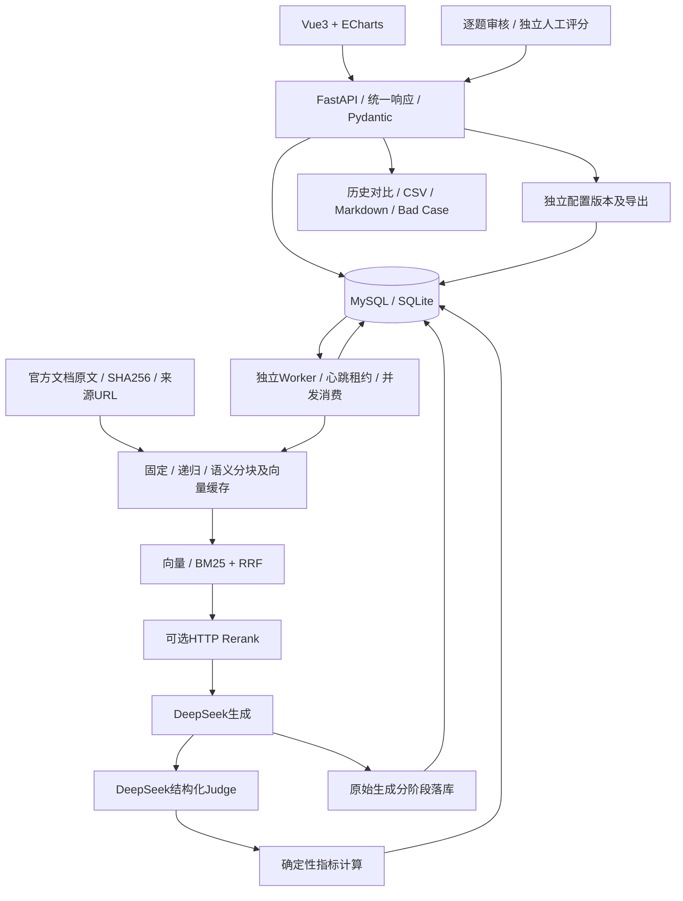

# 架构说明

本平台评估RAG系统的检索、生成、拒答、延迟与成本。业务数据由MySQL持久化；本地快速演示使用同一ORM模型对应的SQLite。

## 代码职责

- `app/schemas.py`：配置边界、题目证据、人工审核字段、Judge分数范围。
- `app/service.py`：验证标准来源、确定基线chunk ID、冻结题集/语料/模型/Prompt/价格、抽取20%题目。
- `app/rag.py`：固定、递归、基于相邻句Embedding的语义分块；保留原文坐标；向量余弦、中文字符/bigram+英文词BM25、RRF融合及Rerank。
- `app/providers.py`：OpenAI-compatible生成/Embedding/Judge、HTTP重排、进程内共享并发与RPM、退避、调用账本；demo模式为独立模拟实现。
- `app/worker.py`：领取任务、更新心跳、回收失联项、逐题状态转换、保存生成后再评分、恢复时跳过成功阶段。
- `app/metrics.py`：检索、质量、性能、费用和一致率聚合；六类归因的初始自动建议。
- `app/main.py`：题集/题目/文档/配置管理、任务控制、逐题下钻、人工核验、历史对照、报告导出。
- `frontend/src/App.vue`：六类工作页面、编辑弹窗、筛选、实时轮询、人工核验入口。

## 数据实体及版本

文档原文使用不可覆盖的ID与内容哈希；更新资料创建新ID。配置修改/克隆生成新ID，完整参数持久化。题目可以编辑，历史运行保存独立快照。Run冻结全部Cases、Documents、Configs、Prompt文本、服务模型/端点、评分阈值、费用与抽样种子。

Item唯一键为`run_id + config_id + case_id`。其`generation`先独立提交，`judgement`随后提交，最后保存`metrics`和状态。因此评分失败后的续跑不会重生成已保存答案。

IndexCache按语料版本、分块策略参数、Embedding服务/模型/模式及实现版本区分。标准证据按原文坐标评测，不依赖跨策略变化的chunk ID。ApiCall记录每个真实服务尝试的角色、模型、用量、状态及耗时，不保存Key或原始授权头。

## 故障和安全边界

一个Worker负责进程内全局限额；任务心跳每2秒更新、30秒无心跳视为失联。数据库唯一约束和条件更新防止重复领取。进程恢复可跳过成功项，但外部API已完成而本地尚未提交的崩溃边界仍可能重复调用/收费。

暂停停止领取新项，等待在途调用完成；UI显示暂停中再转为已暂停。请求重试仅覆盖429、部分超时/暂时服务错误；不可重试的权限或参数错误明确失败。

问题、被评答案和召回材料作为不可信数据进入固定System规则；Judge必须输出经过Pydantic校验的JSON，引用ID须存在。正式任务只使用真实语料，拒绝未人工审核的题集。平台为本地作业工具，当前没有登录/RBAC，不应直接暴露到公共网络。
