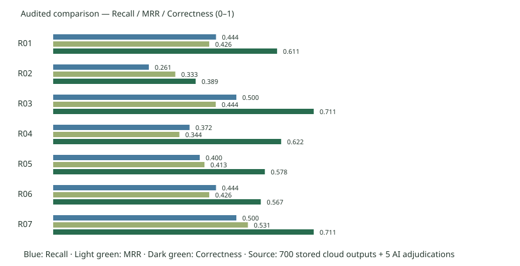

# 配置对比报告：本次实验最终推荐R07

本次实验最终推荐：**R07（混合检索 + 百炼重排）**。R07与R03在本次复核后的非拒答正确率同为64/90（71.11%），R07的MRR为0.5315，高于R03的0.4437，因此在“任务成功率→MRR→延迟”的排序下选择R07。R03作为不需要重排的备选。此推荐适用于当前题集与语料快照，不宣称线上普遍最优。

运行`run-54107b88329d40c8`：23份官方来源、100题、7配置，700/700调用完成。历史运行创建于题集审核登记之前，等级仍为`ai_preliminary`；当前题集登记100/100审核，实质题干/答案/证据与冻结快照一致。本报告应用5条明确归因的AI复核裁决；没有新增云调用，没有把历史运行改名成审核后重跑。

|配置|原非拒答正确率|裁决后正确率|裁决后全题通过|Recall|MRR|平均ms|P95ms|
|---|---:|---:|---:|---:|---:|---:|---:|
|R01 向量 K3|63.33%|61.11%|65.00%|0.4444|0.4259|4031.2|14528.8|
|R02 向量 K1|38.89%|38.89%|45.00%|0.2611|0.3333|4693.1|30465.0|
|R03 向量 K5|71.11%|71.11%|74.00%|0.5000|0.4437|2432.8|3353.5|
|R04 递归分块|63.33%|62.22%|66.00%|0.3722|0.3444|3069.4|20229.2|
|R05 混合检索|58.89%|57.78%|62.00%|0.4000|0.4130|2899.9|18429.2|
|R06 向量阈值0.4|57.78%|56.67%|61.00%|0.4444|0.4259|1923.0|2902.2|
|R07 混合 + 百炼重排|71.11%|71.11%|74.00%|0.5000|0.5315|5171.4|20297.5|

## 控制变量分析

以下使用裁决后口径；括号披露原Judge口径，防止误把评分更正当成模型提升。

- Top-K 3→1：非拒答正确率变化-22.22个百分点（原Judge口径-24.44）。
- Top-K 3→5：非拒答正确率变化+10.00个百分点（原Judge口径+7.78）。
- 递归分块：非拒答正确率变化+1.11个百分点（原Judge口径+0.00）。
- 混合检索：非拒答正确率变化-3.33个百分点（原Judge口径-4.44）。
- 阈值0.4：非拒答正确率变化-4.44个百分点（原Judge口径-5.56）。
- 混合加重排：非拒答正确率变化+13.33个百分点（原Judge口径+12.22）。

本次配对中影响最大的变量是Top-K降到1，正确率下降22.22个百分点；混合检索增加Rerank后提升13.33个百分点。没有为了验证新结论重新收费跑批；这是对同一批输出更正明显误判后的再分析。

## 复核、Bad Case与边界

5条裁决见`Judge复核裁决报告.md`与`Judge复核裁决.json`。原人工对原Judge分类一致率仍是135/140（96.43%），不将AI裁决作为新真人样本。裁决后低分/失败253条；原始Judge口径248条。Bad Case证据报告的10条真实案例来自原始失败集，另有2条明确标注的知识库缺失反事实测试；没有将反事实混入统计。

延迟受到限流等待、执行顺序和运行时段影响，不把观测差异全归因于配置。USD对话费用为生成/Judge参考估算，不含Embedding/Rerank，不等于人民币实际账单。R07不能据对话费用更低就声称总成本更低。拒答题10/10通过不意味着线上拒答零错误。
